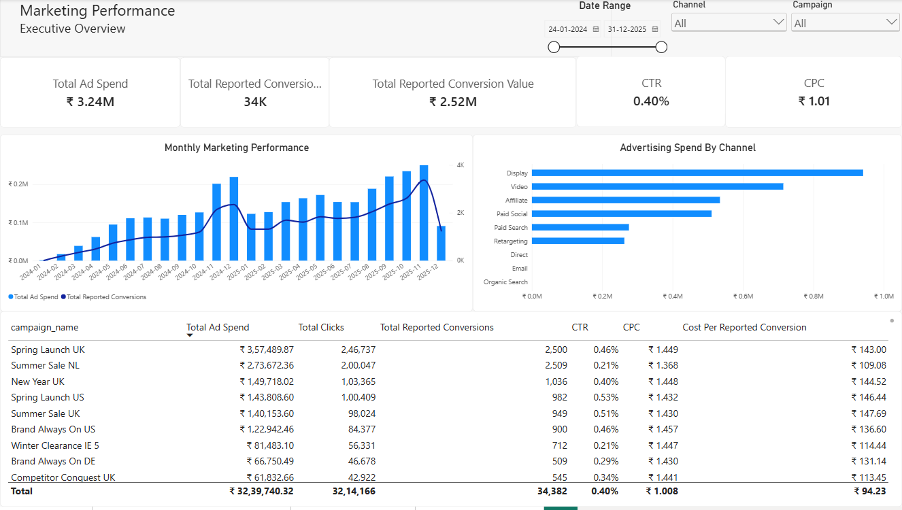
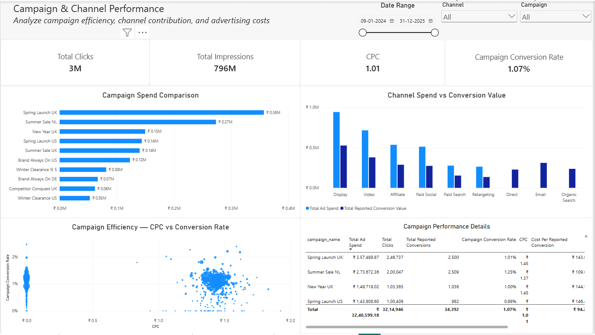
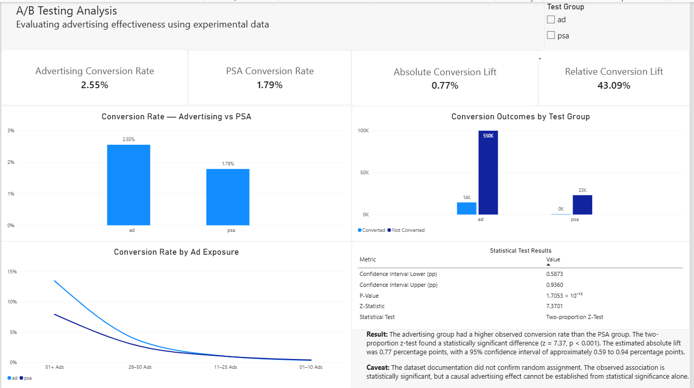
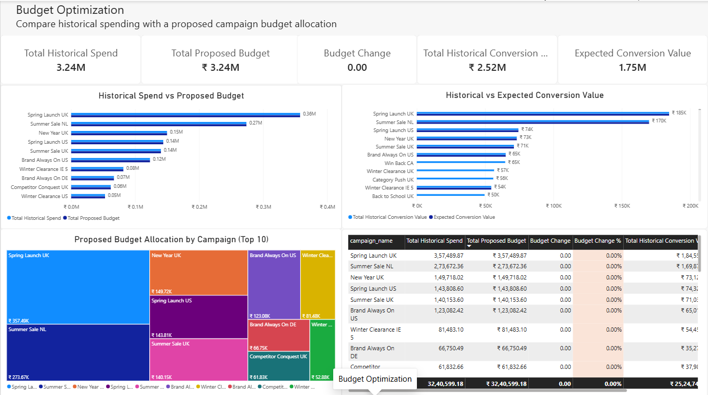

# Marketing Budget Optimization & A/B Testing

An end-to-end marketing analytics project using PostgreSQL, Python, Excel, and Power BI to analyze campaign performance, evaluate advertising effectiveness, examine attribution, and assess proposed marketing budget allocations.

## Project Overview

Marketing teams need to understand which campaigns and channels generate results, whether advertising improves conversion performance, and how marketing budgets can be allocated more effectively.

This project combines campaign performance analysis, multi-touch attribution, statistical A/B testing, and budget scenario analysis into a single analytical workflow.

The project covers the complete analytics process, from data quality checks and SQL-based data modeling to statistical analysis and interactive Power BI dashboards.

## Business Objectives

- Evaluate marketing campaign and channel performance.
- Analyze impressions, clicks, advertising spend, reported conversions, and reported conversion value.
- Compare first-touch and last-touch attribution.
- Evaluate the difference in conversion rates between advertising and PSA groups.
- Quantify the observed conversion lift and assess statistical significance.
- Compare historical campaign spending with a proposed budget scenario.
- Communicate findings through interactive dashboards and documented analytical outputs.

## Technology Stack

| Technology | Purpose |
|---|---|
| PostgreSQL | Data validation, transformation, analytical modeling, aggregation, and attribution analysis |
| SQL | CTEs, joins, aggregations, analytical tables, and views |
| Python | Statistical analysis and experiment evaluation |
| pandas | Data manipulation and analysis |
| NumPy | Numerical calculations |
| SciPy | Statistical testing |
| statsmodels | Statistical inference and confidence intervals |
| Microsoft Excel | Budget allocation scenarios and assumption-based projections |
| Power BI | Interactive dashboards, DAX measures, data modeling, and visualization |
| Git & GitHub | Version control and project presentation |

## Project Workflow

### 1. Data Quality Assessment

Inspected the source data and performed data quality checks before building the analytical model.

The validation process included:

- Checking column names and data types.
- Identifying duplicate identifiers.
- Examining missing values.
- Validating analytical table grain.
- Checking relationships between source and analytical tables.
- Investigating inconsistencies in conversion and delivery-related fields where applicable.

The results of the data quality assessment are documented in the `documentation/` directory.

### 2. PostgreSQL Data Modeling

Transformed the source data into analytical tables and views suitable for campaign performance analysis.

The principal analytical objects include:

**Dimension tables**
- `dim_channel`
- `dim_campaign`
- `dim_ad_group`

**Fact tables**
- `fact_daily_performance`
- `fact_conversion`
- `fact_ab_test_user`

**Campaign performance mart**
- `mart_campaign_performance`

**Analytical views**
- `vw_attribution_by_channel`
- `vw_attribution_comparison`
- `vw_conversion_touchpoints`
- `vw_campaign_budget_allocation`
- `vw_campaign_roas`

The campaign performance mart summarizes campaign-level metrics, while the daily performance fact supports time-based analysis.

The conversion fact supports attribution and conversion-event analysis.

The A/B testing dataset is analyzed separately because it does not share a suitable campaign-level key with the marketing campaign data.

### 3. Campaign Performance Analysis

Analyzed campaign performance using the following metrics:

- Impressions
- Clicks
- Advertising spend
- Reported conversions
- Reported conversion value
- Click-through rate (CTR)
- Cost per click (CPC)
- Cost per reported conversion
- Return on ad spend (ROAS)

The analysis compares performance across campaigns, channels, and time periods.

CTR is calculated as clicks divided by impressions.

CPC is calculated as advertising spend divided by clicks.

Cost per reported conversion is calculated as advertising spend divided by reported conversions.

ROAS is calculated as reported conversion value divided by advertising spend.

ROAS represents reported conversion value relative to advertising spend; it should not be interpreted as profit or overall business ROI.

### 4. Marketing Attribution Analysis

Built SQL views to examine attribution from different perspectives.

The attribution analysis includes:

- First-touch attribution.
- Last-touch attribution.
- Channel-level attributed conversions and conversion value.
- Comparison of attribution results across channels.
- Conversion touchpoint analysis.

The purpose is to investigate how channel contribution changes depending on the attribution method.

Attribution results depend on the available tracking data and attribution definitions. They should not automatically be interpreted as causal estimates of each channel's incremental impact.

### 5. A/B Testing Analysis

Analyzed the advertising experiment dataset using Python, pandas, SciPy, and statsmodels.

The analysis compared the advertising group with the public service announcement (PSA) group.

It included:

- Group sizes and conversion counts.
- Conversion-rate calculation.
- Absolute conversion lift.
- Relative conversion lift.
- Two-proportion z-test.
- P-value and confidence interval.
- Descriptive analysis of advertising exposure by conversion behavior.

#### Experiment results

| Metric | Advertising group | PSA group |
|---|---:|---:|
| Users | 564,577 | 23,524 |
| Converted users | 14,423 | 420 |
| Conversion rate | 2.5547% | 1.7854% |
| Average ads seen | 24.8234 | 24.7611 |

**Observed absolute conversion lift:** approximately 0.7692 percentage points.

**Observed relative conversion lift:** approximately 43.09%.

**Two-proportion z-statistic:** approximately 7.3701.

**P-value:** approximately 1.705 × 10⁻¹³.

**95% confidence interval for the absolute lift:** approximately 0.5873 to 0.9360 percentage points.

The results indicate a statistically significant difference between the observed conversion rates.

However, the available dataset documentation did not confirm random assignment. Statistical significance alone does not establish that advertising caused the observed difference. The results are therefore presented as evidence of an observed association, with the causal interpretation remaining subject to the experiment design.

### 6. Budget Scenario Analysis

Used Microsoft Excel to compare historical campaign spending with a proposed budget allocation scenario.

The scenario analysis includes:

- Historical campaign spending.
- Historical ROAS.
- Proposed campaign budgets.
- Assumed ROAS.
- Historical conversion value.
- Expected conversion value under the scenario assumptions.

The purpose is to evaluate how a proposed allocation compares with historical spending and how the scenario's expected conversion value differs from historical performance.

Expected conversion value is an assumption-based projection, not guaranteed revenue or profit.

The final budget conclusions depend on validating the proposed budget values and assumptions against the source workbook.

### 7. Power BI Dashboard

Created a four-page interactive Power BI report.

#### Page 1 — Executive Overview

Provides a high-level view of marketing performance through:

- Total advertising spend.
- Reported conversions.
- Reported conversion value.
- CTR and CPC.
- Monthly performance trends.
- Advertising spend by channel.
- Campaign-level performance table.



#### Page 2 — Campaign & Channel Performance

Provides more detailed comparisons of campaign and channel efficiency through:

- Total clicks and impressions.
- CPC and conversion rate.
- Campaign spending comparisons.
- Channel spending versus reported conversion value.
- Campaign efficiency scatter plot.
- Campaign performance details.



#### Page 3 — A/B Testing Analysis

Presents the experiment results through:

- Advertising and PSA conversion rates.
- Absolute and relative conversion lift.
- Conversion outcomes by test group.
- Conversion rate by advertising exposure.
- Statistical test results and confidence interval.
- Interpretation and limitations of the findings.



#### Page 4 — Budget Optimization

Compares historical campaign spending with the budget scenario through:

- Historical spending.
- Proposed budget.
- Budget change.
- Historical conversion value.
- Expected conversion value.
- Campaign-level budget comparisons.
- Proposed budget allocation visualization.



## Key Findings

1. **Observed conversion-rate difference:** The advertising group recorded a conversion rate of approximately 2.55%, compared with 1.79% for the PSA group.

2. **Conversion lift:** The observed absolute lift was approximately 0.77 percentage points, equivalent to a relative increase of approximately 43.09% over the PSA conversion rate.

3. **Statistical significance:** The two-proportion z-test returned a p-value of approximately 1.705 × 10⁻¹³. The observed difference is statistically significant under the test's assumptions.

4. **Attribution analysis:** The SQL attribution views enable comparisons between first-touch and last-touch channel attribution.

5. **Budget scenario analysis:** The Excel and Power BI components compare historical campaign metrics with assumption-based proposed budget scenarios. Recommendations depend on the validity of the underlying assumptions and final scenario validation.

Detailed findings and interpretation are available in `documentation/key_findings.md`.

## Repository Structure

```text
marketing-budget-optimization/
│
├── README.md
├── data/
│   └── README.md
├── sql/
├── python/
├── excel/
├── powerbi/
├── screenshots/
└── documentation/
    ├── data_quality_audit.md
    ├── data_dictionary.md
    ├── key_findings.md
    ├── statistical_analysis.md
    └── budget_scenario_assumptions.md
```

The filenames above illustrate the intended organization. Refer to the actual files in the repository for the available scripts and documentation.

## How to Explore the Project

1. Review the data documentation to understand the source datasets and their limitations.
2. Explore the SQL scripts to understand data validation, analytical modeling, campaign metrics, and attribution views.
3. Review the Python notebook for the A/B testing workflow and statistical results.
4. Examine the Excel workbook to understand the budget allocation assumptions.
5. Open the Power BI report to explore the four dashboard pages.
6. Review the findings and methodology documentation for interpretation and limitations.

## Methodological Limitations

- Reported conversions may not represent unique customers or new customer acquisitions.
- ROAS is based on reported conversion value and advertising spend; it does not measure profit.
- Attribution comparisons depend on the available tracking data and attribution definitions.
- The A/B dataset documentation did not confirm random assignment, so causal conclusions require caution.
- Expected conversion value depends on the assumptions in the budget scenario workbook.
- Campaign-level metrics and daily fact metrics represent different levels of detail and should not be added together.
- Historical and proposed budget comparisons must be validated against the underlying scenario workbook.

## Skills Demonstrated

- SQL data quality assessment and analytical data modeling.
- PostgreSQL joins, CTEs, aggregations, and analytical views.
- Campaign and channel performance analysis.
- Marketing attribution analysis.
- Python data manipulation and statistical inference.
- A/B testing and confidence interval interpretation.
- Excel-based budget scenario analysis.
- Power BI data modeling, DAX measures, and interactive visualization.
- Business interpretation, analytical documentation, and data storytelling.

## Conclusion

This project demonstrates an end-to-end marketing analytics workflow that combines structured SQL analysis, statistical experimentation, scenario modeling, and interactive business intelligence reporting.

It provides a foundation for evaluating marketing performance and communicating evidence-based findings while explicitly documenting data limitations and analytical assumptions.
